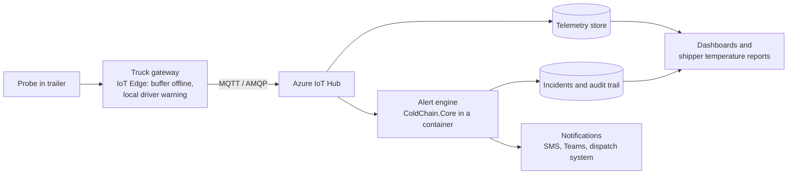

# From POC to production

The alert engine (`src/ColdChain.Core`) is pure .NET with no I/O, so it moves to production unchanged. What changes is how data arrives, where it is stored, and how much infrastructure Nimbus runs. The brief doesn't state fleet size, so this document gives options by scale and budget.

## Target architecture (Azure)

The truck gateway explains most of the data problems in the brief. It buffers readings during signal loss and sends them later, which is why data arrives with gaps, out of order, and occasionally twice. The engine's reorder buffer, duplicate handling and silence rules exist because of that behaviour.

## Storage

Telemetry and incidents behave in opposite ways, so they live in different stores.

| | Telemetry | Incidents and audit trail |
|---|---|---|
| Volume | High: 1,000 trucks at 5-min cadence is about 105 million rows a year | Low: thousands of rows |
| Writes | Append-only | Updated: acknowledged, resolved, annotated |
| Queries | Time windows and aggregates | Lookups, joins, change history |
| Key need | Cheap, fast storage at scale; multi-year retention | Integrity and traceability for audits |
| Large fleet | **Azure Data Explorer** (native IoT Hub ingestion, time-series functions, retention policies), with **Data Lake Storage** for the long-term archive | **Azure SQL Database** with **temporal tables** (automatic change history) and **ledger tables** (tamper-evident records for pharma audits) |
| Mid-size or cost-sensitive | **PostgreSQL + TimescaleDB** for both, in one database (check current extension support on Azure Database for PostgreSQL), or Azure SQL with a columnstore telemetry table | Same database |

In the POC, `IIncidentStore` has an in-memory and a JSON-file implementation. A production store is one new class behind the same interface.

## Deployment by fleet size

| Layer | Mid-size (a few hundred trucks) | Large (thousands, multi-region) |
|---|---|---|
| On the truck | Gateway sends direct to cloud | IoT Edge: offline buffering, local driver warning |
| Onboarding | Scripted device registration | Device Provisioning Service |
| Ingestion | IoT Hub, one standard unit | IoT Hub, Event Hubs for fan-out |
| Alert engine | One container on Azure Container Apps | Same engine on AKS, partitioned by truck |
| Engine state | Same database | Azure Cache for Redis |
| Alerts | Azure Communication Services (SMS, email), Teams | Integrated with ServiceNow or PagerDuty and the dispatch system via Service Bus |
| Dashboards | Power BI | Power BI or Grafana, plus a portal where shippers see their own shipments |
| Resilience | Single region, managed backups | Multi-region failover for ingestion and alerting |

A mid-size customer that grows moves to the large design without rewriting the engine: swap the store implementation and change where the container runs.

## Cost options

| | Fully open source | Hybrid (recommended for mid-size) | Fully managed Azure |
|---|---|---|---|
| Stack | Mosquitto or EMQX (MQTT), PostgreSQL + TimescaleDB, Grafana, engine in Docker; MQTTnet for .NET | IoT Hub (one unit) + engine on Container Apps + managed PostgreSQL + Grafana | IoT Hub, ADX, Azure SQL, AKS, Power BI |
| Cloud bill | Lowest | Low | Highest |
| Ops effort | Highest: security patching, certificates, uptime, backups, on-call | Low | Lowest |
| Fits | In-house IT team or on-premises requirement | Most mid-size fleets | Large fleets with a platform team |

IoT Hub itself is not the expensive part at mid-size scale: a few hundred trucks at 5-minute cadence send roughly 60,000 messages a day, which fits one standard unit. The costly parts of the full design are ADX, AKS, and running many separate services.

The biggest cost lever is usually data volume, not platform choice. Cellular data plans and hardware often cost more than the cloud. Report-by-exception at the gateway (every 15 min when stable and well inside limits, every minute near a limit) and batching readings cut cellular, messaging and storage costs together, while the local edge rule still warns the driver instantly.

The real comparison is total cost: infrastructure, plus the people to run it, plus the risk of a missed excursion. The cheapest design on paper is not the cheapest one to run.

## Where AI fits, and where it doesn't

Rules decide; AI advises. Every decision that affects cargo stays deterministic and auditable, and every AI feature degrades gracefully if the model is unavailable.

| Idea | Role | When |
|---|---|---|
| Plain-English alert summaries | An LLM turns the engine's computed facts into a short message for ops. It receives facts only, no raw logs or customer data | Next increment |
| Draft deviation reports | Drafts the excursion report a pharma shipper needs; a person reviews before sending | Next increment |
| Failing cooling unit prediction | Slow drift, longer recovery after door openings; start with per-truck statistical baselines (ADX has built-in anomaly functions) before any ML | Once months of fleet history exist |
| Learned normal behaviour | Ranks or annotates alerts using each truck's patterns; must never suppress a real excursion | Later |

AI is not used for the alert decision itself, and never to fill in missing sensor data. In a safety system, missing data is unknown, not a guess.
